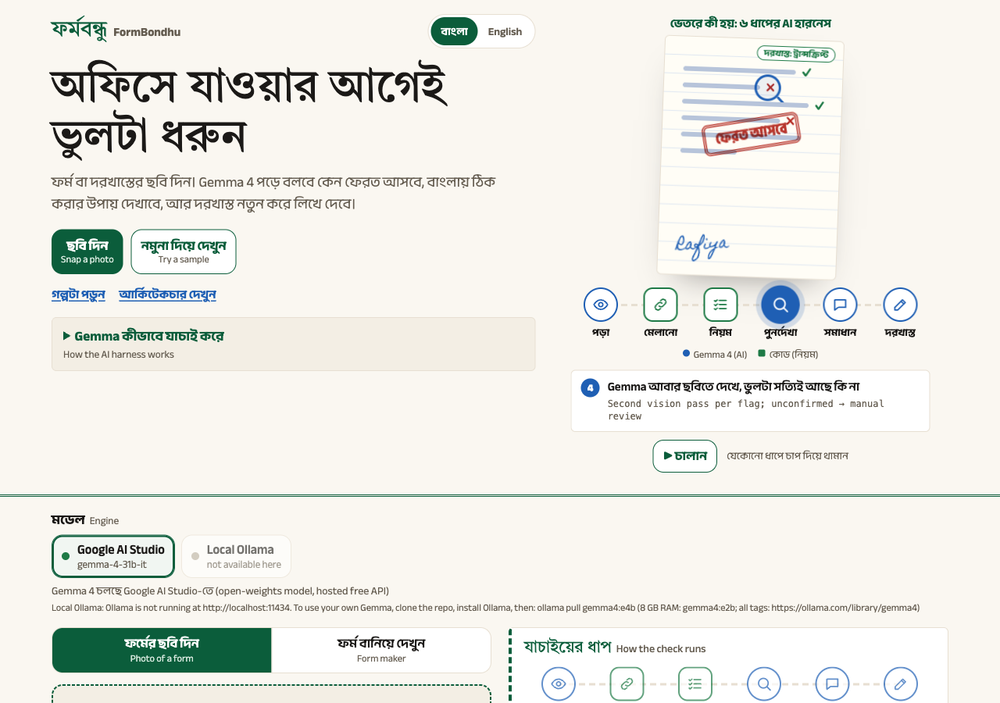
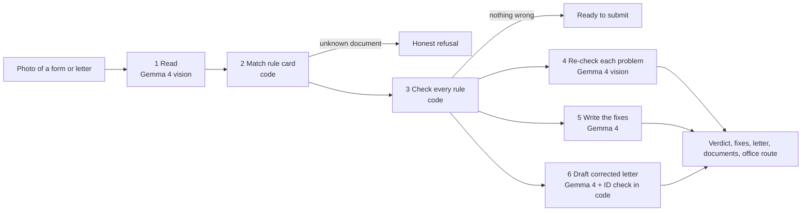
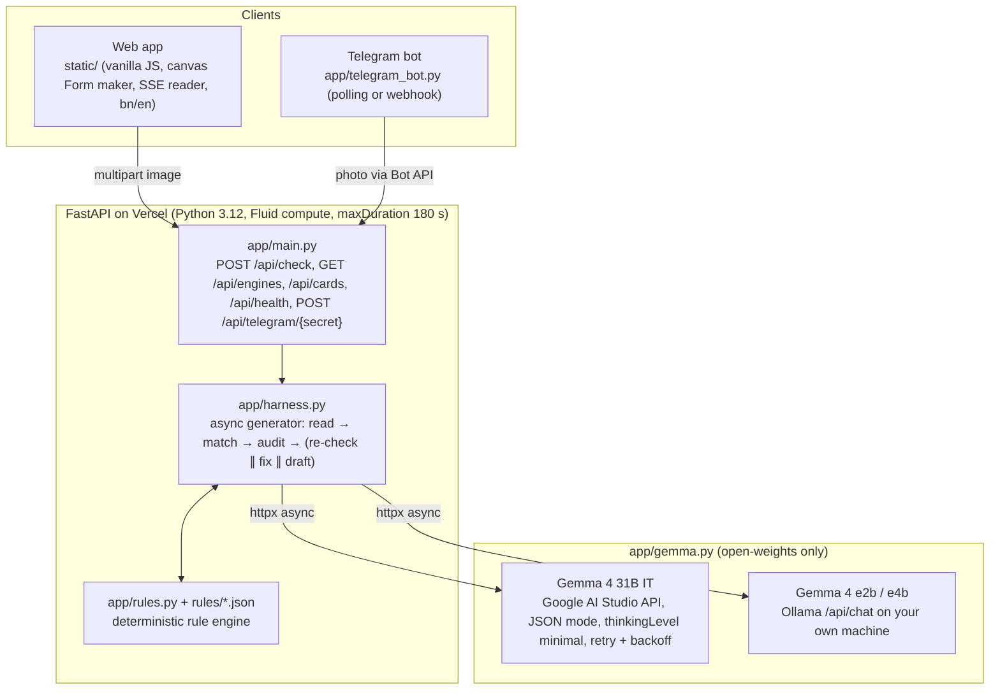
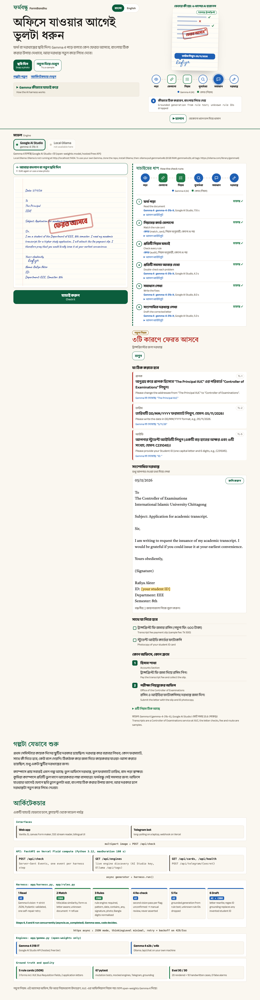
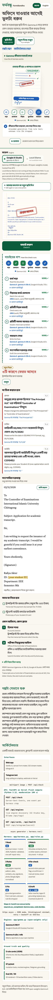

# FormBondhu (ফর্মবন্ধু)

Photograph a filled university form or a handwritten application letter (দরখাস্ত). An AI harness built on **open-weights Gemma 4** finds what will get it returned at the office window, explains each fix in Bangla and English, and for letters writes a corrected version from the student's own details, before the trip to the office.

**Live app: https://formbondhu.vercel.app** · Repo: https://github.com/ai-naymul/formbondhu · Demo video: _added after recording_



## The problem

At IIUC, as the event's problem statement puts it, "simple paperwork means visiting three offices". Every semester students write leave and transcript applications, and fill printed forms for transcripts, duplicate ID cards and bus requisitions. Most of them learn the format by copying a senior's photo. Most also commute 60–90 minutes each way between the city and the Kumira campus.

A letter addressed to the wrong office, a missing student ID, a date written as `5/11/26`, or a blank signature gets the paper handed back. That means another day and another round trip.

Today students ask seniors on Messenger, or learn the rules by being rejected. Office staff repeat the same corrections all day. Club and department organisers face the same thing with requisitions.

## The solution

FormBondhu checks the paper before you leave home.
- You take a photo, or build a document in the built-in Form maker.
- Gemma 4 works out whether it is a printed form or a free-text letter, and copies every value exactly as written.
- Plain code checks it against that document's rule card.
- Gemma 4 looks at the image again to confirm each problem, then writes the fix in Bangla and English.
- For letters, Gemma 4 also drafts a corrected formal letter using only facts the student wrote, with highlighted `[placeholders]` where something is missing.
- You also get the documents to bring and the order of offices to visit.

It works in a phone browser (Bangla or English interface) and through a Telegram bot.

## How it works

### The 6-step harness



| # | Step | Who | What happens | Code |
|---|---|---|---|---|
| 1 | Read | **Gemma 4 (vision)** | Decides form vs letter. Copies every field value exactly as written, and reports whether signature and photo boxes are filled. Output is strict JSON, validated by Pydantic, with one self-repair retry if the shape is wrong. | `app/harness.py` `READ_PROMPT`, `call_validated` |
| 2 | Match | **Code** | Matches the title or subject to a rule card by similarity, separately for forms and letters. An unknown document is refused, never guessed. | `app/rules.py` `match_card` |
| 3 | Rules | **Code** | Rule engine over the read values: `required`, `pattern`, `date`, `contains_any`, `signature`, `photo`. Bangla digits are normalised (২৬/১০/২০২৬ is a valid date). | `app/rules.py` `audit` |
| 4 | Re-check | **Gemma 4 (vision)** | A second look at the image for each flagged problem. Unconfirmed problems go to "check yourself" instead of being stated as fact. | `VERIFY_PROMPT`, `apply_verification` |
| 5 | Fix | **Gemma 4** | Bangla and English fix for each problem, written only from the rule's own text. Fixes that cite a rule id not on the card are dropped. | `EXPLAIN_PROMPT`, `merge_explanations` |
| 6 | Draft | **Gemma 4 + code** | Letters only: a corrected formal letter in the student's language. Code then replaces any student ID that differs from the one read from the original. | `DRAFT_PROMPT`, `ground_draft` |

Steps 4–6 run concurrently with `asyncio.as_completed`. Each step is streamed to the browser as a Server-Sent Event, showing who ran it (Gemma 4 or code), the model, the time taken and the raw output.

**Gemma sees, code decides.** Fees, offices, deadlines and rules only ever come from the human-written rule cards in `rules/*.json`, never from the model.

### Architecture



**Model:**
- [Gemma 4 31B IT](https://huggingface.co/google/gemma-4-31b-it), an open-weights model from Google DeepMind ([docs](https://ai.google.dev/gemma/docs/core)), served by default through the free [Google AI Studio](https://aistudio.google.com) API.
- Or any Gemma 4 model on your own machine with [Ollama](https://ollama.com/library/gemma4). The app's engine picker lists every Gemma model Ollama has installed.
- No closed models are used anywhere.

**Tech stack:**
- Backend: Python 3.12, FastAPI, httpx (async), Pydantic.
- Frontend: plain HTML, CSS and JavaScript, no build step.
- Interfaces: Telegram Bot API.
- Tooling: pytest, Pillow (evaluation), Vercel.

**Datasets:** none.
- The five rule cards are sample data marked `"sample_data": true`. Offices, fees and formats in them are not official IIUC policy.
- The Bus Requisition card's field list is taken from IIUC's online [Bus Requisition Form](https://www.iiuc.ac.bd/bus-requisition-form.html).
- All test images are synthetic.

### API

| Method and path | What it does |
|---|---|
| `POST /api/check` | Multipart `image` (plus optional `backend`, `model`). Streams Server-Sent Events: one `step` event per harness step, then a `result` or `error`. |
| `GET /api/engines` | Which engines this server can use right now: AI Studio (key present?) and Ollama (live `/api/tags` probe, Gemma models only). |
| `GET /api/cards` | The rule cards (used by the Form maker). |
| `GET /api/health` | Health check: `{"ok": true, "cards": 5}`. |
| `POST /api/telegram/{secret}` | Telegram webhook; rejected unless the path matches `TELEGRAM_WEBHOOK_SECRET`. |

### What it checks

| Document | Kind | Used by | Example rules |
|---|---|---|---|
| Transcript application | form | Student | ID pattern, DD/MM/YYYY date, signature, photo |
| Bus Requisition (IIUC field list) | form | Department or club | 11-digit BD mobile, real bus date, clock time, passenger count |
| Duplicate ID card | form | Student | GD number, session `2020-21`, signature, photo |
| Transcript application letter | letter | Student | addressed to the Controller of Examinations, ID, subject, request, signature |
| Leave application letter | letter | Student | addressed to the Chairman or course teacher, leave dates, reason, signature |

**Add a document:** drop one JSON file into `rules/` with its kind, fields, signatures, rules, attachments, office route and three demo mistakes. No code changes are needed.

### Project structure

```
app/
  main.py          FastAPI app and endpoints
  harness.py       the 6-step pipeline, prompts, Pydantic schemas, ID grounding
  rules.py         rule cards, matching, field mapping, audit (no model calls)
  gemma.py         Gemma 4 client: Google AI Studio and Ollama, retry, engine discovery
  telegram_bot.py  Telegram front end (polling or webhook)
rules/             5 rule cards (JSON)
static/            web app: index.html, app.js, style.css
tests/             67 pytest tests (rules, engines, harness guards, Telegram)
eval/              end-to-end evaluation script, test images, results
demo/              pitch script, manual test guide, handwriting sheets, deploy guide
```

## How to run it

1. Clone the repo and install:
   ```bash
   git clone https://github.com/ai-naymul/formbondhu.git && cd formbondhu
   python3 -m venv .venv && source .venv/bin/activate
   pip install -r requirements-dev.txt
   cp .env.example .env
   ```
2. Choose how Gemma 4 runs. You can set up both and switch in the app.
   - **Google AI Studio (hosted Gemma 4):** get a free key at [aistudio.google.com](https://aistudio.google.com) and set `GEMMA_API_KEY` in `.env`.
   - **Your own machine (local Gemma 4):** install [Ollama](https://ollama.com), run `ollama pull gemma4:e4b` (use `gemma4:e2b` on 8 GB RAM), and keep Ollama running. The engine picker shows it as **Local Ollama**; set `DEFAULT_BACKEND=ollama` to make it the default. In this mode nothing leaves your machine.
3. Start the app with `uvicorn app.main:app --reload`, then open http://localhost:8000.
   - On a phone on the same Wi-Fi: run `uvicorn app.main:app --host 0.0.0.0` and open `http://<laptop-ip>:8000`.
4. Run the tests with `pytest`. All 67 tests run offline, with the engines mocked.
5. **Telegram bot (optional):**
   - Create a bot with [@BotFather](https://t.me/BotFather) and set `TELEGRAM_BOT_TOKEN` in `.env`.
   - Run `python -m app.telegram_bot` and send the bot a photo.
   - When deployed, use the webhook route instead (steps in `demo/DEPLOY.md`).
6. **Deploy:** `vercel deploy --prod` with `GEMMA_API_KEY` set as a Vercel environment variable. `vercel.json` sets `maxDuration` to 180 s.

## Evaluation

`python eval/run_eval.py` sends every test image through the real `/api/check`. The expected problems for each image are written down before the run.

| Test set | Cases | Exact result | Problems caught | False alarms |
|---|---|---|---|---|
| Form maker renders, crisp and simulated phone photo (tilt, blur, JPEG 55) | 20 | 20 / 20 | 30 / 30 | 0 |
| Handwritten letters, local server ([details](eval/RESULTS_HANDWRITING.md)) | 10 | 10 / 10 | 18 / 18 | 0 |
| Handwritten letters, **live site** formbondhu.vercel.app ([details](eval/RESULTS_HANDWRITING_LIVE.md)) | 10 | 10 / 10 | 18 / 18 | 0 |

**Handwritten test set:**
- English letters were turned into handwriting on lined paper with an online text-to-handwriting tool ([codeshack.io](https://codeshack.io/text-to-handwriting/)), in three styles from neat to cursive.
- The Bangla letter uses the Galada handwriting-style font, signed with either a wavy pen line or a cursive name.

**Bug found and fixed:** in a manual test, a thin wavy-line signature was once missed. The prompts now treat any pen stroke as a signature, and the second look only confirms "not signed" when the area is blank. The first run's report is kept in `eval/`.

A check takes about 15–30 seconds on the free API; letters take longest because of the drafting step.

## Screenshots / demo

| Desktop (live site, transcript letter with three mistakes) | Phone, 390 px |
|---|---|
|  |  |

**On the page:**
- The hero storyboard plays the six steps; tap any step to stop on it.
- Check folds the editor away, so the document (with its verdict stamp) and the live analysis sit side by side.
- The page also has a "Why I built this" story and an Architecture section.

**Accessibility and languages:**
- A read-aloud button for the verdict.
- A full Bangla/English switch.
- The page respects reduced motion.

## What's not done yet

- **Sample rules only:** offices, fees and formats in the rule cards haven't been checked with IIUC offices. Only the Bus Requisition field list comes from IIUC.
- **Local Ollama mode isn't proven end to end:** it's implemented and unit-tested against mocked responses, but wasn't run against a real model during the event.
- **Five document types** so far.
- **Real handwriting:** photos of real handwritten paper had only light testing; the evaluation images are generated.
- **No accounts or history,** by design: images are processed in memory and never stored. In hosted mode they go to the Google AI Studio API; in local mode they stay on your machine.

## Credits

- Gemma 4 by Google DeepMind, served through Google AI Studio or Ollama.
- FastAPI, Uvicorn, httpx, Pydantic, pytest and Pillow.
- Fonts: Anek Bangla, Tiro Bangla, Caveat, Homemade Apple and Galada, from Google Fonts.
- Cream palette adapted from BanglaLLM's [BanglaSafe](https://banglallm.github.io/banglasafe/) page.
- Handwritten test letters made with [codeshack.io's text-to-handwriting tool](https://codeshack.io/text-to-handwriting/).
- Built with help from Claude Code, an AI coding assistant, as the rulebook allows.

License: MIT.
