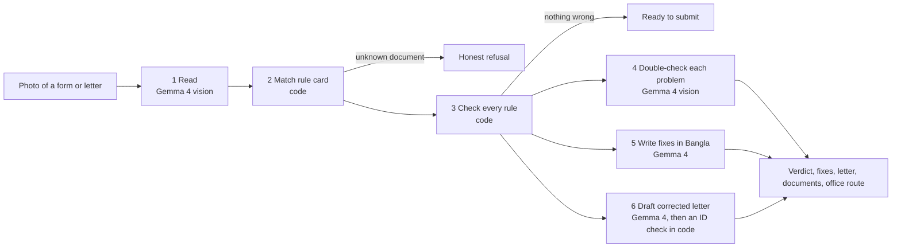

# FormBondhu (ফর্মবন্ধু)

Photograph a filled university form or a handwritten application letter (দরখাস্ত). Gemma 4 finds what will get it returned at the office window, explains each fix in Bangla, and for letters writes a corrected version from the student's own details, before the trip to the office.

**Live demo:** _Vercel link added after deploy_ · **Video:** _added after recording_


## The problem

At IIUC, as the event's problem statement puts it, "simple paperwork means visiting three offices". Every semester, students write transcript and leave applications by copying a senior's photo of one, and fill printed forms for transcripts, duplicate ID cards and bus requisitions. Most of them commute 60–90 minutes each way between the city and the Kumira campus.

A letter addressed to the wrong office, a missing student ID, a date written as `5/11/26`, or a blank signature gets the paper handed back. That means another day and another round trip.

Today students ask seniors on Messenger, or learn the rules by being rejected. Office staff repeat the same corrections all day. Club and department organisers face the same thing with requisitions.

## The solution

FormBondhu checks the paper before you leave home.
- You take a photo, or build one in the built-in Form maker.
- Gemma 4 works out whether it's a printed form or a free-text letter, and reads every value exactly as written.
- Plain code checks it against that document's rule card.
- Gemma 4 looks again to confirm each problem and writes the fix in Bangla.
- For a letter, Gemma 4 also drafts a corrected formal letter using only the facts the student wrote, with visible placeholders where something is missing.
- You also get the documents to bring and the order of offices to visit.

## How it works



**Gemma sees, code decides.** The model does the parts that need language and vision. Code does the parts that need to be exactly right.
- **Reading:** Gemma 4 reads printed Bangla/English labels, handwriting, and free-form letters in Bangla, English or Banglish. It pulls letters into fixed slots: addressee, date, subject, request, student ID and so on.
- **Every problem traces to a written rule.** Each flag points to a rule id in a human-written rule card (`rules/*.json`). Rule types: `required`, `pattern`, `date`, `contains_any` (e.g. "a transcript letter must be addressed to the Controller of Examinations"), `signature` and `photo`.
- **The second look can only remove problems, never add them.** Anything it can't confirm is shown as "check this yourself" instead of being stated as fact.
- **Fixes and drafts can't invent facts.** Explanations that cite a rule id not on the card are dropped. In drafted letters, code replaces any student ID that doesn't match the one read from the original.
- **Everything is visible.** The interface shows every step as it runs: who ran it (Gemma 4 or code), the model, how long it took, and the raw output.

**What it checks:**

| Document | Used by | Where the content comes from |
|---|---|---|
| Transcript application form | Student | Sample form |
| Bus Requisition Form | Department or club | Field list from IIUC's online [Bus Requisition Form](https://www.iiuc.ac.bd/bus-requisition-form.html); checks are samples |
| Duplicate ID card form | Student | Sample form |
| Transcript application letter (দরখাস্ত) | Student | Transcripts are an IIUC [Controller of Examinations](https://iiuc.ac.bd/administration/coe) service; checks are samples |
| Leave application letter (দরখাস্ত) | Student | Usual Bangladeshi university format; checks are samples |

**Details:**
- **Model:** [Gemma 4 31B IT](https://huggingface.co/google/gemma-4-31b-it), an open-weights model from Google DeepMind ([docs](https://ai.google.dev/gemma/docs/core)).
  - By default it runs through the free [Google AI Studio](https://aistudio.google.com) API.
  - Or run any Gemma 4 model on your own machine with [Ollama](https://ollama.com/library/gemma4).
  - No closed models are used anywhere.
- **Interfaces:** a phone-first web app, and a Telegram bot that runs the same harness.
- **Tech stack:** Python 3.12, FastAPI, httpx, Pydantic. Plain HTML, CSS and JavaScript (no build step), with a canvas-drawn Form maker for forms and ruled-paper letters. pytest. Vercel.
- **Datasets:** none. The rule cards are sample data marked `"sample_data": true`; offices, fees and formats in them are not official IIUC policy. The images in `samples/` are synthetic.
- **Add a document:** drop one JSON file into `rules/` with its kind (form or letter), fields, signatures, rules, attachments, office route and three demo mistakes. No code changes needed.

## How to run it

1. Clone the repo and install:
   ```bash
   git clone https://github.com/ai-naymul/formbondhu.git && cd formbondhu
   python3 -m venv .venv && source .venv/bin/activate
   pip install -r requirements-dev.txt
   cp .env.example .env
   ```
2. Choose how Gemma 4 runs. You can set up both and switch in the app's engine bar.
   - **Google AI Studio (hosted Gemma 4):** get a free key at [aistudio.google.com](https://aistudio.google.com) and set `GEMMA_API_KEY` in `.env`.
   - **Your own machine (local Gemma 4):** install [Ollama](https://ollama.com), then run `ollama pull gemma4:e4b` (use `gemma4:e2b` on 8 GB RAM) and keep Ollama running. The engine bar lists every Gemma model Ollama has; choose **Local Ollama**. To make it the default, set `DEFAULT_BACKEND=ollama` in `.env`. Nothing leaves your machine in this mode.
3. Run the app with `uvicorn app.main:app --reload` and open http://localhost:8000.
   - To try it from a phone on the same Wi-Fi, run `uvicorn app.main:app --host 0.0.0.0` and open `http://<laptop-ip>:8000`.
4. Run the tests with `pytest`. There are 57 tests: rule mutation tests, a check that every card's demo mistakes trip exactly three rules, offline engine and Telegram tests, and draft-grounding tests. `pip install -r requirements-dev.txt` also installs Pillow for the evaluation.

**Telegram bot (same harness, no app to install):** students already share photos in chat apps, and a bot works on any phone over weak mobile data.
1. Create a bot with [@BotFather](https://t.me/BotFather) and put `TELEGRAM_BOT_TOKEN` in `.env`.
2. Run `python -m app.telegram_bot` from the project folder. This polls Telegram, so it works from a laptop with no public URL.
3. Send the bot a photo of a form or application letter. It replies with the verdict, Bangla fixes, the corrected letter for application letters, and the office route.

When deployed, use webhook mode instead: set `TELEGRAM_WEBHOOK_SECRET`, then point Telegram at `https://<your-domain>/api/telegram/<secret>` with `setWebhook`.

**Deploy:** `vercel.json` is included. Set `GEMMA_API_KEY` as a Vercel environment variable. On a hosted copy, Local Ollama shows as unavailable; clone the repo to use your own Gemma.

## Evaluation

`python eval/run_eval.py` sends every rule card through the live `/api/check`, both filled correctly and with its three demo mistakes. Each image is tested twice: as a crisp render, and as a simulated phone photo (3.5° tilt, blur, shrunk, JPEG quality 55). The expected problems are fixed in advance by applying the card's rules to a perfect read. Full table: [eval/RESULTS.md](eval/RESULTS.md).

| Measure | Result |
|---|---|
| Exact result (right document and exactly the expected problems) | 20 / 20 |
| Planted problems caught (recall) | 30 / 30 |
| Flags that were real problems (precision) | 30 / 30 |
| False alarms on the 10 correctly filled documents | 0 |
| Corrected letters passing the ID grounding check | 4 / 4 |
| Time per check | median 23 s, max 30 s |

Limits: these images come from the app's own Form maker, written in a handwriting-style font, so the results prove the pipeline end to end but not accuracy on real handwriting. Photos of real handwritten paper are the next test set.

## Screenshots / demo

| Desktop | Phone (390 px) |
|---|---|
|  |  |

## What's not done yet

- **Sample rules only:** offices, fees and formats in the rule cards are samples and haven't been checked with IIUC offices. The Bus Requisition field list is the only part taken directly from IIUC.
- **Local Ollama mode isn't proven end to end:** it's implemented and unit-tested against mocked Ollama responses, but it wasn't run against a real model during the event because the build laptop had no Ollama.
- **Five document types** so far.
- **Light testing on real phone photos** of handwritten Bangla letters. Clear, flat photos work best.
- **Speed:** a full check takes about 10–30 seconds on the free API; letters take longest because of the extra drafting step.
- **No accounts or history,** by design: no student data is stored. Images are processed in memory. In hosted mode they go to the Google AI Studio API; in local mode they stay on your machine.

## Credits

- Gemma 4 by Google DeepMind, served through Google AI Studio or Ollama.
- FastAPI, Uvicorn, httpx, Pydantic and pytest.
- Fonts: Anek Bangla, Tiro Bangla and Caveat from Google Fonts.
- Cream palette adapted from BanglaLLM's [BanglaSafe](https://banglallm.github.io/banglasafe/) page.
- Built with help from Claude Code, an AI coding assistant, as the rulebook allows.

License: MIT.
