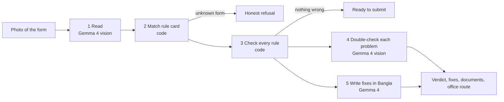

# FormBondhu (ফর্মবন্ধু)

Photograph a filled university paper form. Gemma 4 finds what will get it returned at the office window and explains the fix in Bangla, before the student makes the trip.

**Live demo:** _Vercel link added after deploy_ · **Video:** _added after recording_


## The problem

At IIUC, as the event's problem statement puts it, "simple paperwork means visiting three offices". Students fill transcript applications, make-up exam forms and duplicate ID forms by copying a senior's photo of one. Most of them commute 60–90 minutes each way between the city and the Kumira campus. A missing signature, a date written as `12/3/26` instead of `12/03/2026`, or no passport photo gets the form handed back at the window. That means another day and another round trip.

Today students cope by asking seniors on Messenger, or they learn the rules by being rejected. Office staff repeat the same corrections all day.

## The solution

FormBondhu checks the form before you leave home.
- You take a photo, or build a form in the built-in Form maker. Gemma 4 reads every field, signature box and photo box.
- Plain code checks what it read against the office's rule card.
- Gemma 4 takes a second look to confirm each problem, then writes a short fix in Bangla.
- You also get the documents to bring and the order of offices to visit.

## How it works



**Gemma sees, code decides.**
- Every problem traces back to a rule id in a human-written rule card (`rules/*.json`).
- Gemma's second look can only remove a problem, never add one.
- Explanations that cite a rule id not on the card are dropped, so the model cannot invent fees, offices or deadlines.
- The interface shows every step as it runs: who ran it (Gemma 4 or code), how long it took, and the raw output.

**Details:**
- **Model:** [Gemma 4 31B IT](https://huggingface.co/google/gemma-4-31b-it), an open-weights model from Google DeepMind ([docs](https://ai.google.dev/gemma/docs/core)).
  - By default it runs through the free [Google AI Studio](https://aistudio.google.com) API.
  - Or run any Gemma 4 vision model on your own machine with [Ollama](https://ollama.com/library/gemma4).
  - No closed models are used anywhere.
- **Tech stack:** Python 3.12, FastAPI, httpx, Pydantic. Plain HTML, CSS and JavaScript (no build step), with a canvas-drawn Form maker. pytest. Vercel.
- **Datasets:** none.
  - The three rule cards (transcript, make-up exam, duplicate ID) are made-up sample data, marked `"sample_data": true`. They are not official IIUC policy.
  - The images in `samples/` are synthetic.
- **Add a form:** drop one JSON file into `rules/` with its fields, signatures, photo requirement, rules (`required`, `pattern`, `date`, `signature`, `photo`), attachments and office route. No code changes needed.

## How to run it

1. Clone the repo and install:
   ```bash
   git clone https://github.com/ai-naymul/formbondhu.git && cd formbondhu
   python3 -m venv .venv && source .venv/bin/activate
   pip install -r requirements-dev.txt
   cp .env.example .env
   ```
2. Choose how Gemma 4 runs. You can set up both and switch in the app's engine bar.
   - **Google AI Studio (hosted Gemma 4):** get a free key at [aistudio.google.com](https://aistudio.google.com) and set `GEMMA_API_KEY` in `.env`.
   - **Your own machine (local Gemma 4):** install [Ollama](https://ollama.com), then run `ollama pull gemma4:e4b` (use `gemma4:e2b` on 8 GB RAM) and keep Ollama running. The engine bar lists every Gemma model Ollama has; choose **Local Ollama**. To make it the default, set `DEFAULT_BACKEND=ollama` in `.env`. Nothing leaves your machine in this mode.
3. Run the app with `uvicorn app.main:app --reload` and open http://localhost:8000.
   - To try it from a phone on the same Wi-Fi, run `uvicorn app.main:app --host 0.0.0.0` and open `http://<laptop-ip>:8000`.
4. Run the tests with `pytest`. There are 34 tests: rule mutation tests and offline engine tests.

**Deploy:** `vercel.json` is included. Set `GEMMA_API_KEY` as a Vercel environment variable. On a hosted copy, Local Ollama shows as unavailable; clone the repo to use your own Gemma.

## Screenshots / demo

| Desktop | Phone (390 px) |
|---|---|
|  |  |

## What's not done yet

- **Sample rules only:** the offices, fees and ID formats in the rule cards are invented for the demo and haven't been checked with IIUC offices.
- **Local Ollama mode isn't proven end to end:** it's implemented and unit-tested against mocked Ollama responses, but it wasn't run against a real model during the event because the build laptop had no Ollama.
- **Only three form types** are covered.
- **Light testing on real phone photos** of handwriting, especially handwritten Bangla. Clear, flat photos work best.
- **Speed:** a full check takes about 10–25 seconds on the free API.
- **No accounts or history,** by design: no student data is stored. Images are processed in memory. In hosted mode they go to the Google AI Studio API; in local mode they stay on your machine.

## Credits

- Gemma 4 by Google DeepMind, served through Google AI Studio or Ollama.
- FastAPI, Uvicorn, httpx, Pydantic and pytest.
- Fonts: Anek Bangla, Tiro Bangla and Caveat from Google Fonts.
- Built with help from Claude Code, an AI coding assistant, as the rulebook allows.
