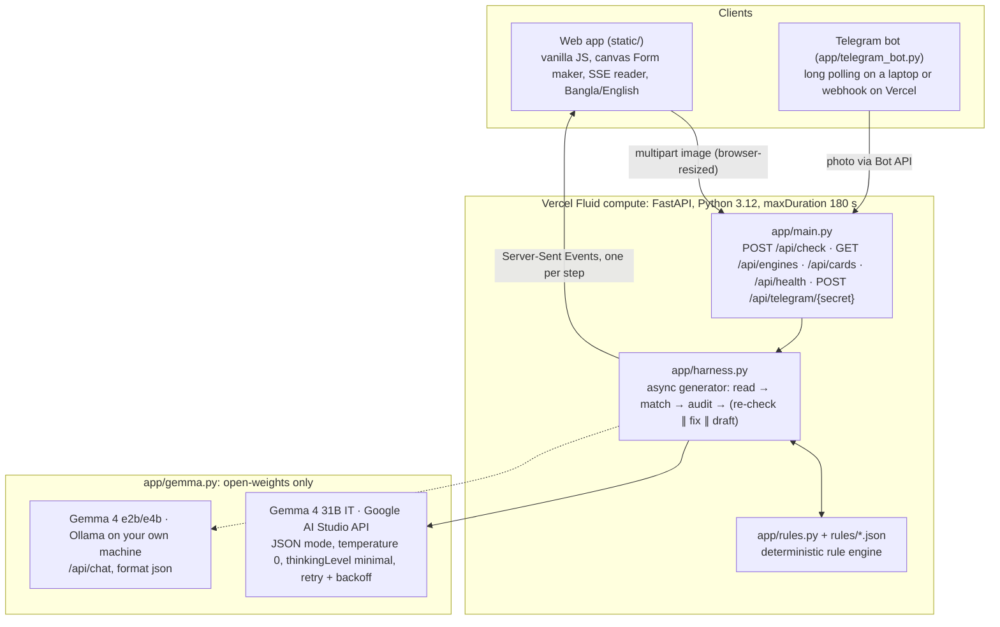
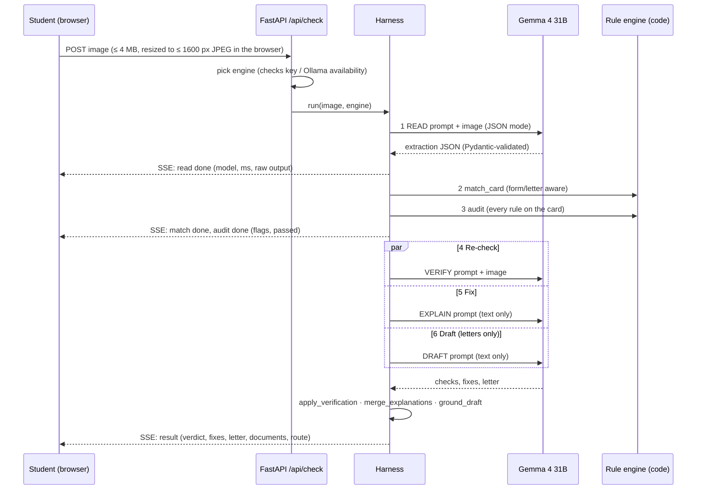

# FormBondhu: judge pack

Everything needed to explain FormBondhu end to end: what it does, how every part works, the numbers, and answers to the questions judges usually ask.

**Live:** https://formbondhu.vercel.app · **Code:** https://github.com/ai-naymul/formbondhu

---

## 0. The 30-second version

> Students at IIUC lose whole days because a form or application letter gets handed back for a small mistake: wrong office, missing ID, wrong date format, no signature. FormBondhu checks the paper **before** the trip. You photograph a form or a handwritten দরখাস্ত, and a six-step harness built on **open-weights Gemma 4** reads it, checks it against the office's rules, double-checks every problem, explains the fix in Bangla, and rewrites letters from your own details. **Gemma sees, code decides**, so it never invents a fee, an office or an ID.

### Numbers to remember

| | |
|---|---|
| Harness steps | 6 (Read, Match, Rules, Re-check, Fix, Draft): 4 use Gemma 4, 2 are pure code, and the Draft step is also code-checked |
| Model | Gemma 4 31B IT (open weights), via Google AI Studio API; any Gemma 4 via Ollama locally |
| Gemma calls per check | 1 if the document is fine or unknown, 3 if it has problems, 4 for a letter with problems |
| Time per check | about 15–30 s (median 24 s on the live site) |
| Documents | 5 rule cards: 3 forms (incl. IIUC Bus Requisition field list) and 2 application letters |
| Rules | 38 rules across 6 rule types |
| Tests | 67 pytest tests, all offline (48 rules, 12 engines, 3 harness guards, 4 Telegram) |
| Evaluation | 20/20 rendered + 10/10 handwritten locally + 10/10 handwritten on the live site; 0 false alarms |
| Code size | about 2,250 lines (Python, JS, CSS, HTML) |
| Interfaces | phone-first web app (Bangla/English) and Telegram bot |

---

## 1. The problem

- **Who:** every IIUC student, a few times a semester, plus department and club organisers filing bus requisitions. Office staff at the other side of the window feel it too.
- **The pain:**
  - The rulebook itself says "simple paperwork means visiting three offices".
  - Students copy a senior's application from a photo, address it to the wrong office, forget the ID or signature, or write the date as `5/11/26`.
  - The paper comes back, and at the Kumira campus that means another 60–90 minute bus ride each way.
- **How they cope today:** asking seniors on Messenger, guessing, or learning the rules by being rejected.
- **Why AI is needed and not just a form:** the input is a **photo of paper**, often handwritten and in Bangla or Banglish, and letters are free text with no fixed fields. Reading that reliably needs a vision-language model. Deciding what is wrong does not, so that part is code.

## 2. What the student does

1. Open https://formbondhu.vercel.app on a phone (or message the Telegram bot).
2. Tap **ছবি দিন** (Snap a photo) and photograph the form or letter. Or use the **Form maker** to build one.
3. Tap **যাচাই করুন** (Check). The editor folds away and the analysis runs live beside the document.
4. Get:
   - a stamped verdict (ফেরত আসবে or জমা দেওয়ার জন্য প্রস্তুত)
   - each problem with the fix in Bangla and English, plus what Gemma saw
   - for letters, a corrected letter with `[placeholders]` highlighted
   - the documents to bring and the order of offices to visit

## 3. Live demo script (2 minutes)

1. **Hook (15 s):** "At IIUC a missing signature doesn't cost five minutes, it costs another bus ride to Kumira."
2. **Storyboard (15 s):** point at the hero animation: "These are the six steps; blue is Gemma 4, green is plain code."
3. **Run (45 s):** tap **নমুনা দিয়ে দেখুন** (Try a sample) → **যাচাই করুন**. Narrate the live rail: "Gemma reads it… code matches the rule card and checks every rule… Gemma double-checks, writes the fixes, drafts the letter."
4. **Result (20 s):** red stamp, three problems (wrong office, date, missing ID), and the corrected letter addressed to the Controller with `[your student ID]` instead of an invented number.
5. **Judge test (20 s):** "Edit again" → let the judge change something (fix the ID, sign the pad) → Check → the result changes. That proves nothing is cached.
6. **Close (5 s):** open **আর্কিটেকচার দেখুন** (View the architecture) and **আসল আউটপুট** (Raw output) on any step.

**If the Wi-Fi is bad:** use a phone hotspot. If the API itself fails, show the error honestly and use the screenshots in `docs/`. Never pretend.

---

## 4. Architecture



### One request, step by step



---

## 5. The harness in depth

**Principle: Gemma sees, code decides.** The model does the parts that need vision and language: reading paper and handwriting, and writing Bangla. Code does everything that must be exactly right: which rules apply, what is wrong, which fees and offices to show.

### Step 1: Read (Gemma 4 vision)

- **File:** `app/harness.py` (`READ_PROMPT`, `Extraction`, `call_validated`).
- **Input:** the image.
- **What the prompt asks:**
  - Decide `doc_type`: `form` or `letter`.
  - Copy every value **exactly as written** (`12/3/26` stays `12/3/26`), so the date rule can judge it.
  - For letters, fill fixed slots: Addressee, Date, Subject, Request, Leave Dates, Reason, Student Name, Student ID, Department, Semester.
  - Signature: *any* pen mark counts as ink (cursive name, initials, scribble, one wavy line).
  - Photo box: present and filled.
  - Report the language: `bn`, `en` or `mixed`.
- **Output schema (Pydantic):**
  ```
  Extraction { doc_type, language, form_title,
               fields: [ {label_en, label_bn, value, is_empty} ],
               signature_boxes: [ {label, has_ink} ],
               photo_box: {present, filled} }
  ```
- **Self-repair:** if the JSON doesn't match the schema, the validation error is sent back to Gemma for one retry (`call_validated`).

### Step 2: Match (code)

- **File:** `app/rules.py` `match_card`.
- **How:** the extracted title (form) or subject line (letter) is compared to each card's English title, Bangla title and aliases.
  - Exact match scores 1.0.
  - Containment scores 0.75 plus a length bonus.
  - Otherwise the score is `SequenceMatcher` similarity.
  - The search only looks at cards of the same kind, so a transcript *letter* never matches the transcript *form*.
- **Threshold:** 0.6. Below that, the document is refused ("অচেনা ফর্ম", unknown document) and nothing is guessed.

### Step 3: Rules (code)

- **File:** `app/rules.py` `map_fields`, `audit`.
- **Field mapping:** each card field is matched to an extracted field by English or Bangla label similarity, so "Date", "Date (DD/MM/YYYY)" and "তারিখ" all land on the same key. Bangla digits are converted (২৬ → 26).
- **Rule types:**

| Type | Meaning | Example |
|---|---|---|
| `required` | must not be blank | leave dates (LV-3) |
| `pattern` | regex | student ID `^[A-Z]\d{6}$`, BD mobile `^(\+?88)?01[3-9]\d{8}$` |
| `date` | DD/MM/YYYY (`/`, `.` or `-`), real calendar date, 4-digit year | `31/02/2026` fails |
| `contains_any` | must mention one of these | transcript letter must be addressed to "Controller of Examinations" / "পরীক্ষা নিয়ন্ত্রক" |
| `signature` | that signature box must have ink | TL-7, LV-7 |
| `photo` | photo box must be filled (only when the card requires it) | TR-7 |

- **Rule cards** (`rules/*.json`) also hold the attachments, office route, sample values, three demo mistakes, and a `source` line saying what's real and what's sample.

### Step 4: Re-check (Gemma 4 vision)

- **Prompt:** `VERIFY_PROMPT`. For each flagged problem Gemma looks at the image again and returns `{rule_id, confirmed, seen}`. It confirms only what it can actually see. For signatures it is told that any pen stroke means signed.
- **Code:** `apply_verification`. Only explicitly confirmed problems are shown as problems. Unconfirmed ones go to "নিজে একবার দেখুন" (check these yourself).
- **Why:** the second look can only **remove** problems, never add them, which cuts false alarms.

### Step 5: Fix (Gemma 4 text)

- **Prompt:** `EXPLAIN_PROMPT`. One short Bangla fix and one English fix per problem, using only the rule's text and what was read. Dates and IDs must be in English digits.
- **Code:** `merge_explanations`. Fixes citing a rule id that wasn't flagged are dropped. If the model skips one, the card's own text is used, so output never depends on the model behaving.

### Step 6: Draft (Gemma 4 text + code check, letters only)

- **Prompt:** `DRAFT_PROMPT`. Rewrite the letter in the student's language (formal Bangla or formal English) in the usual Bangladeshi format.
  - It must keep every detail the student gave and use only those facts.
  - It writes `[placeholders]` for anything missing and fixes the flagged problems.
  - The addressee comes from the rule card.
- **Code:** `ground_draft`. Any student ID in the draft that differs from the one read from the original (regex `\b[A-Z]\d{6}\b`) is replaced with a visible placeholder. The step output records `grounding_check: passed` or how many IDs were replaced.

Steps 4–6 run **concurrently** (`asyncio.as_completed`), so the slowest one sets the time, not the sum.

### Why a harness and not one prompt

- **One prompt** would mix seeing, judging and writing. When it's wrong you can't tell which part failed, and nothing stops it from inventing a fee.
- **Split into steps:**
  - Each Gemma call has one job and a strict schema.
  - The verdict is deterministic and testable (67 tests).
  - Every step is visible in the UI with its raw output.
  - Adding a new document is data (one JSON file), not code.

---

## 6. Engines and the model

- **Gemma 4 31B IT**, an open-weights model by Google DeepMind ([model card](https://huggingface.co/google/gemma-4-31b-it)). It's vision-capable and handles Bangla.
- **Google AI Studio API** (`app/gemma.py`):
  - `generateContent` with `responseMimeType: application/json`, temperature 0, `thinkingConfig.thinkingLevel: minimal`.
  - **Why minimal thinking:** in testing, a form read took 40–48 s per call with default thinking and 8–11 s with minimal, with the same answers.
  - Timeout 90 s. One retry after 2 s on 429, 5xx or a timeout, with a plain "API is busy, wait a minute" message if it still fails.
- **Ollama, local** (`/api/chat`, `format: json`, temperature 0, 180 s timeout):
  - Any Gemma 4 model you've pulled (e.g. `gemma4:e4b`, or `gemma4:e2b` on 8 GB RAM). Nothing leaves your machine.
  - The engine picker discovers installed Gemma models live through `/api/tags`.
  - **Honest note:** this path is unit-tested with mocked Ollama responses but wasn't run against a real model during the event.
- **Rulebook compliance:** the app runs only on open-weights models; no closed model is called anywhere.

## 7. API and streaming

| Endpoint | Purpose |
|---|---|
| `POST /api/check` | multipart `image` (+ optional `backend`, `model`); returns `text/event-stream` |
| `GET /api/engines` | available engines and models (AI Studio key present? Ollama reachable with Gemma models?) |
| `GET /api/cards` | rule cards for the Form maker |
| `GET /api/health` | `{"ok": true, "cards": 5, "default_engine": "aistudio"}` |
| `POST /api/telegram/{secret}` | Telegram webhook, 404 unless the secret matches |

**Upload limits:** 4 MB max (under Vercel's 4.5 MB limit), with only `image/jpeg`, `image/png` and `image/webp` accepted. The browser resizes photos to at most 1600 px as JPEG quality 0.85 before upload, which keeps it light on mobile data.

**Example event** (one per step, then a result):
```
data: {"type":"step","id":"read","status":"done","kind":"model","backend":"aistudio",
       "model":"gemma-4-31b-it","ms":18103,"retried":false,"output":{"doc_type":"letter", ...}}
data: {"type":"step","id":"audit","status":"done","kind":"code","tool":"audit",
       "output":{"flagged":["LV-1","LV-2","LV-3"],"passed":["LV-4","LV-5","LV-6","LV-7"]}}
data: {"type":"result","status":"problems","problems":[...],"manual":[],"draft":{...},
       "attachments":[...],"route":[...],"engine":{...},"ms":25311}
```

## 8. Frontend (static/)

- **No framework, no build step:** plain HTML, CSS and JavaScript, so it loads fast on low-end phones.
- **Form maker:** draws a realistic form or a handwritten letter on ruled paper with `<canvas>`, including a finger/mouse signature pad. That image goes through exactly the same `/api/check` as a photo, which is how judges can change inputs live.
- **Live streaming:** reads the SSE stream with `fetch` + `ReadableStream`. If a host buffers the stream, events simply arrive together and the UI still renders.
- **Live rail and step list:** each step shows who ran it (Gemma 4 or code), the model, the time and the raw JSON output.
- **Storyboard:** the hero plays the six steps on a 12 s loop. Tapping a step uses the **Web Animations API** to seek every animation to that step and pause.
- **Review mode:** after Check, the editor folds away. On desktop, the stamped document stays pinned (`position: sticky`) beside the results.
- **Bilingual:** a Bangla/English switch covers every label and the model's fixes.
- **Accessibility:**
  - A read-aloud button (`speechSynthesis`, with a Bangla voice when available).
  - `aria-live` regions, keyboard focus styles and reduced-motion support.
- **Verified:** no horizontal scroll and no clipped labels, at 1280 px and 390 px, in both languages.

## 9. Telegram bot (`app/telegram_bot.py`)

- **What it does:** a student sends a photo (or an image file) to the bot.
  - It downloads the largest size through `getFile`, runs the same harness, and replies with the verdict, fixes, documents and route as HTML.
  - Corrected letters come as a second message. All model text is HTML-escaped.
- **Two modes:**
  - `python -m app.telegram_bot`: long polling, which works from a laptop with no public URL.
  - Webhook on Vercel: `POST /api/telegram/{TELEGRAM_WEBHOOK_SECRET}`.

## 10. Deployment

- **Where:** Vercel (team FlannelAI), Fluid compute, Python 3.12, `maxDuration` 180 s (set after one 52 s run during testing).
- **Configuration:**
  - FastAPI is auto-detected at `app/main.py`.
  - The `/static` mount is promoted to Vercel's CDN.
  - `GEMMA_API_KEY` is stored as an encrypted environment variable, never in the repo.
  - `.vercelignore` keeps tests, evaluation images and `.env` out of the deploy.
- **Commands:** health check with `curl https://formbondhu.vercel.app/api/health`. Redeploy with `vercel deploy --prod --scope flannel-ai`.

## 11. Quality

### Tests (67, all offline, `pytest`)

- **`test_rules.py` (48):**
  - A clean form gives zero flags.
  - **Mutation tests:** one planted mistake raises exactly one rule.
  - Every card's three demo mistakes raise exactly three rules.
  - Plus: matching, forms vs letters, unknown documents refused, label variants, Bangla digits and date separators, verification merge, and that explanations can't invent problems.
- **`test_engines.py` (12):**
  - Request and response shape for both engines, using a mocked HTTP layer.
  - Retry on a 429, and the clear rate-limit message.
  - Engine discovery when Ollama is down, running without Gemma, or running with Gemma.
  - The health endpoint.
- **`test_harness.py` (3):** a draft keeps the real ID and removes invented ones, and the read prompt lists every letter slot.
- **`test_telegram.py` (4):** the /start message, photo → harness → verdict and letter, the honest unknown-form reply, and that the webhook rejects a wrong secret.

### End-to-end evaluation (`eval/run_eval.py`)

- **Method:** every image goes through the real `/api/check`.
  - **Expected problems** are fixed before the run by applying the card's rules to a perfect read.
  - **Exact** means the right card and exactly the expected problems.

| Set | Cases | Exact | Caught | False alarms |
|---|---|---|---|---|
| Form maker renders, crisp + simulated phone photo (3.5° tilt, blur, JPEG 55) | 20 | 20/20 | 30/30 | 0 |
| Handwritten letters, local | 10 | 10/10 | 18/18 | 0 |
| Handwritten letters, **live site** | 10 | 10/10 | 18/18 | 0 |

- **Handwritten set:**
  - English letters were made with an online text-to-handwriting tool in three styles, from neat print to cursive.
  - The Bangla letter is in the Galada handwriting-style font, signed with either a wavy line or a cursive name.
- **Bug we found and fixed:** in a manual test, a thin wavy-line signature was once missed ("not signed" false alarm). The prompts were changed so any pen stroke counts and the second look only confirms a truly blank area, and the evaluation was re-run. The first run's report is kept in `eval/`.

## 12. Security and privacy

- **No storage:** images are processed in memory and never stored. There are no accounts or databases.
- **Where data goes:**
  - **Hosted mode:** the image goes to the Google AI Studio API.
  - **Local mode:** nothing leaves the machine.
- **Secrets:**
  - The API key lives only in server environment variables.
  - The Telegram webhook is protected by a secret path.
  - A secret scan runs before every commit.
- **Input handling:**
  - Upload size and type limits.
  - All model and user text is HTML-escaped in the web UI and in Telegram.
- **Data:** sample data only. Names and IDs in samples are made up, as the rulebook requires.

## 13. Performance and cost

- **Typical times:**
  - Read: 13–20 s.
  - Re-check: 3–7 s, Fix: 7–9 s and Draft: 6–7 s, running in parallel.
  - Total: 15–30 s. Forms with no problems finish after a single call.
- **Cost:** free tier of the Gemma API; at most 4 model calls per check. Running locally with Ollama costs nothing per check.

## 14. Design decisions (HCI)

- **Familiar metaphor:** an office rubber stamp, red "ফেরত আসবে" or green "জমা দেওয়ার জন্য প্রস্তুত", so the verdict reads instantly.
- **Visible system status:** a live six-step rail plus the step list with timings, so the 20–30 s wait is never a blank spinner.
- **Recognition over recall:** chips instead of dropdowns (which broke on phones), Bangla-first labels with English beneath, and a one-tap sample.
- **Error prevention and honesty:**
  - Unknown documents are refused.
  - Unconfirmed problems are shown as "check yourself", not as facts.
  - Placeholders are highlighted instead of guessed.
- **Context kept:** after Check, the document stays beside the analysis, and "Edit again" brings the editor back.
- **Jargon where it helps:** each storyboard caption has a plain line for students and a technical line for developers.

## 15. Rulebook compliance

| Requirement | How it's met |
|---|---|
| Real campus problem | the rulebook's own paperwork line; forms and letters students actually file |
| Open-source model at the heart | Gemma 4 (open weights) for all AI steps, named and linked in the README |
| Interface anyone can use | phone web app in Bangla/English plus a Telegram bot |
| Public repo, regular commits, README template | github.com/ai-naymul/formbondhu, README follows the template |
| Sample data, no personal data | all names and IDs made up; rule cards marked `sample_data` |
| No faked demo | every result is a live model call; judges can edit inputs; raw output is shown |
| No secrets in repo | `.env` is gitignored; the key is a Vercel encrypted environment variable |

## 16. Honest limitations and what's next

- **Limitations:**
  - **Rules are samples:** they haven't been verified with IIUC offices yet. The Bus Requisition field list is the only part taken directly from IIUC.
  - **Real handwriting:** photos of real handwritten paper had only light testing; the evaluation images are generated.
  - **Local Ollama:** not run against a real model during the event.
- **Next:**
  1. Offices publish their own rule cards (one JSON file each).
  2. More documents: testimonial, certificates, course add/drop.
  3. Notices and class routines through the same harness.
  4. A real handwriting test set collected with consent.

---

## 17. Questions judges usually ask

**"Isn't this just a ChatGPT wrapper?"**
No. One Gemma call reads the paper. The decision is made by a deterministic rule engine with 48 tests. A second Gemma pass can only remove problems, and code checks the generated letter for invented IDs. Every step is visible with its raw output.

**"Why not just ask ChatGPT or Gemini to check it?"**
A general chatbot doesn't know which office takes which application, what to attach, or the date and ID formats. It can also confidently invent all of those. Here those facts come only from rule cards, the output is the same every time for the same input, and it runs on an open model, even fully offline.

**"Are these real IIUC rules?"**
They're sample rules, and the app says so on screen. The Bus Requisition fields come from IIUC's own online form. The harness is the product: an office adds its real rules as one JSON file, with no code changes.

**"How do you stop hallucinations?"**
Four guards:
1. Strict JSON schemas, with a self-repair retry.
2. Facts only from rule cards.
3. A second vision pass that can only remove problems.
4. Fixes limited to flagged rule ids, plus regex ID grounding on drafted letters.

**"How accurate is it?"**
On 40 end-to-end cases (20 rendered forms, 10 handwritten letters locally, 10 on the live site): every case exact, every planted problem caught, 0 false alarms. The honest limit is that the images are generated; real paper photos are next.

**"What if the photo is blurry or the handwriting is messy?"**
The test set includes simulated phone photos (tilt, blur, heavy JPEG). If a value can't be read, the rule fires and the second look decides. Anything uncertain goes to "check yourself". The raw output of step 1 shows exactly what was read.

**"Is Gemma 4 really open-source if you call an API?"**
The weights are open. AI Studio is just the free host. The same app runs any Gemma 4 model locally through Ollama, and the engine picker shows both options.

**"Why is it 20–30 seconds?"**
It makes up to four careful model calls. We cut each call from about 45 s to about 10 s with minimal thinking, and run the last three in parallel. Progress is shown live so it never feels stuck.

**"What about privacy?"**
Nothing is stored. In local mode nothing leaves the device.

**"Can I break it?"**
Please try. Change any field, clear the signature, or photograph any paper. Unknown documents are refused honestly.

**"How does it handle Bangla?"**
Gemma reads Bangla and Banglish handwriting. Bangla digits are normalised before the rules run. Fixes and drafted letters come back in formal Bangla, with dates and IDs in English digits because that's what offices accept.

**"Why a Telegram bot?"**
Students already share photos in chat apps, and a bot works on any phone over weak data. The rulebook lists it as an accepted interface.

**"How did you build it in one day?"**
With Claude Code as a coding assistant, which the rulebook allows. The design is my own: the harness split, the rule cards, the grounding guards and the evaluation. I can walk through any file.

**"What would you do with more time?"**
Verify the rules with the Exam Controller's office, collect a consented set of real handwriting, add more documents, and let offices maintain their own rule cards.

---

## 18. Glossary

| Term | Meaning here |
|---|---|
| Harness | the fixed pipeline around the model: prompts, schemas, tools, checks and ordering |
| Open weights | the model's weights are public; anyone can run it, e.g. with Ollama |
| Vision-language model | a model that reads images and text together (Gemma 4) |
| JSON mode / strict schema | the model must answer in a fixed JSON shape; Pydantic rejects anything else |
| Grounding | output may only use facts from a trusted source (rule cards, the student's own letter) |
| Deterministic | same input, same verdict: plain code, not the model, decides problems |
| Mutation test | plant one mistake, check exactly one rule fires |
| Precision / recall | share of flags that were real / share of real problems flagged |
| SSE (Server-Sent Events) | a one-way stream from server to browser; one event per harness step |
| `asyncio.as_completed` | runs the last three model calls at the same time and handles each as it finishes |
| Fluid compute | Vercel's serverless runtime used for the FastAPI function |
| Webhook / long polling | two ways a Telegram bot receives messages: Telegram pushes to a URL, or the bot asks repeatedly |
| `thinkingLevel: minimal` | Gemma API setting that skips long internal reasoning; 4× faster here with the same answers |

## 19. Where to look in the code

| Question | File |
|---|---|
| The six steps and their prompts | `app/harness.py` |
| Rule engine, matching, Bangla digits | `app/rules.py` |
| Rules for each document | `rules/*.json` |
| Gemma client, retry, local Ollama | `app/gemma.py` |
| Endpoints and streaming | `app/main.py` |
| Telegram | `app/telegram_bot.py` |
| UI, Form maker, storyboard | `static/app.js`, `static/style.css`, `static/index.html` |
| Tests | `tests/` |
| Evaluation and results | `eval/run_eval.py`, `eval/RESULTS*.md` |
| Pitch, test guide, deploy guide | `demo/` |
